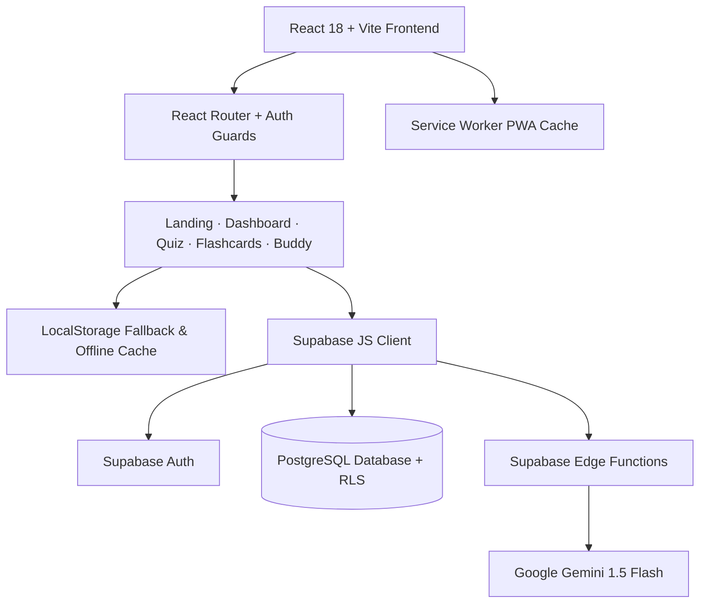

<div align="center">
  

  <p><strong>Study smart. Know when you're ready.</strong></p>
  <p>An unofficial, AI-powered exam-prep platform for <strong>Microsoft Azure Fundamentals (AZ-900)</strong>, built for African learners, Kenya first.</p>

  <p>
    <a href="https://github.com/Obraims/africloud-prep/actions"></a>
    <a href="https://github.com/Obraims/africloud-prep"></a>
    <a href="https://prettier.io"></a>
    <a href="https://react.dev"></a>
    <a href="https://vite.dev"></a>
    <a href="https://supabase.com"></a>
    <a href="https://vercel.com"></a>
    <a href="LICENSE"></a>
  </p>

  <p>
    <a href="https://africloud-prep.vercel.app"><strong>Explore Live Demo</strong></a>
    ·
    <a href="#quickstart">Quickstart</a>
    ·
    <a href="#features">Features</a>
    ·
    <a href="#architecture">Architecture</a>
  </p>
</div>

---

> [!NOTE]  
> **Unofficial Study Tool**: AfriCloud Prep is an independent educational tool designed for the Power Learn Project **Vibe Coding Hackathon: AZ-900 Exam Prep Edition** (`#1MillionDevs`). It is not affiliated with or endorsed by Microsoft. All 90 questions in the question bank are original and mapped to the public Microsoft Learn AZ-900 curriculum.

---

## The Problem & The Solution

### The Challenge

Most cloud certification material is designed around abstract enterprise infrastructure with examples alien to emerging African engineers. Learners repeatedly encounter three critical roadblocks:

1. **Abstract analogies:** European or US corporate banking examples make IAM, availability zones, and governance confusing.
2. **Scattered tools:** Studying across disparate quiz websites, flashcard apps, and docs breaks continuity.
3. **The Readiness Guesswork:** Learners often ask: _"Am I actually ready to book the $99 exam, or am I just memorizing answers?"_

### The AfriCloud Prep Solution

AfriCloud Prep unites the preparation lifecycle into a single closed-loop learning engine:

- **Localized analogies:** Concepts explained through **M-Pesa agent networks**, **Matatu SACCO fleet operations**, and **County by-laws** in **English**, **Kiswahili**, or **Sheng**.
- **Pure-math readiness score:** An auditable, unit-tested gate (`calculateReadiness`) that calculates the exact percentage gap required to unlock "Exam-Ready" status.
- **Leitner spaced repetition:** Diagnostic mistakes automatically flow into a 5-box Leitner flashcard review queue.
- **Zero-barrier demo mode:** Fully functional offline demo fallback with local storage persistence when Supabase credentials are not configured.

---

## Features

### 1. Readiness Tracker & Arc Gauge

- Real-time semicircle gauge tracking progress against the 3 official AZ-900 exam domains:
  - **Domain 1 (25–30%):** Cloud Concepts
  - **Domain 2 (35–40%):** Azure Architecture & Services
  - **Domain 3 (30–35%):** Azure Management & Governance
- **Strict readiness unlock criteria**:
  1. Minimum **30 questions** answered.
  2. Over the last 50 questions, overall accuracy >= 80%.
  3. Every domain accuracy >= 70% with at least 8 answered questions in each domain.
- Displays explicit actionable feedback when locked (e.g. _"Raise Governance by 9% to unlock"_).

### 2. Diagnostic & Practice Quiz

- 90 original, categorized practice questions mapped to official Microsoft Learn objectives.
- Immediate rationale on every choice explaining both why the correct answer is right and why the distractors are wrong.
- Deep-links directly to official Microsoft Learn documentation for further reading.

### 3. Leitner Spaced-Repetition Flashcards

- 5-box Leitner scheduling intervals (1, 2, 4, 7, 14 days).
- 3D interactive flip card with fluid physics and full keyboard accessibility:
  - `Space`: Flip card
  - `ArrowLeft` / `ArrowRight`: Navigate cards
  - `1`: Review soon (retry)
  - `2`: Got it (advance box)

### 4. AI Study Buddy (Mwalimu)

- Conversational tutor accessible in **English**, **Kiswahili**, or **Sheng**.
- Connects abstract cloud mechanisms to relatable Kenyan analogies:
  - _Availability Zones_ -> Separate M-Pesa agent shops in Westlands vs. Upper Hill.
  - _Shared Responsibility Model_ -> Matatu owner (vehicle/insurance) vs. Driver (route/passengers).
  - _Azure Policy & RBAC_ -> County by-laws vs. SACCO vault keyholders.
- Powered by Google Gemini through secure Supabase Edge Functions with an offline analogy fallback bank.

### 5. Installable Progressive Web App (PWA)

- Standardized web manifest with custom standalone display mode.
- Service worker (`sw.js`) caching core app shells and assets for low-bandwidth learning environments.
- 1-click **"Install App"** button built directly into the navigation bar.

---

## UI/UX Design System

AfriCloud Prep implements a bespoke high-contrast neon palette optimized for readability:

| Token             | Hex Code  | Visual Application                                    |
| :---------------- | :-------- | :---------------------------------------------------- |
| **Jet Black**     | `#050505` | Background canvas, deep bento cards                   |
| **Card Surface**  | `#121212` | Elevated bento card backgrounds                       |
| **Cerulean Blue** | `#007BA7` | Primary brand accent, progress arcs, readiness status |
| **Neon Rose**     | `#FF007F` | Secondary interactive highlights, badges, warnings    |
| **Border Gray**   | `#242424` | Crisp, modern card borders                            |
| **Slate White**   | `#F8FAFC` | Primary text with high WCAG AA contrast               |

---

## Architecture & Technology Stack



### Technology Highlights

- **Frontend Core:** React 18, Vite 7, modern ES2022 JavaScript.
- **Styling & Animation:** Tailwind CSS, Framer Motion, Recharts, Lucide Icons.
- **Backend & Storage:** Supabase (PostgreSQL with Row Level Security, Secure Auth, Edge Functions).
- **AI Engine:** Google Gemini API via Supabase Edge Functions.
- **Testing & Quality:** Node test runner (`scripts/run-tests.js`), ESLint Flat Config (`eslint-plugin-react`), Prettier.

---

## Repository Structure

```
africloud-prep/
├── docs/                      # Architectural specs, demo scripts, pitch outline
├── public/
│   ├── brand/                 # Cerulean & Neon Rose SVGs, PNGs, and app icons
│   ├── manifest.webmanifest   # PWA application manifest
│   └── sw.js                  # PWA offline service worker
├── scripts/
│   ├── run-tests.js           # 11 unit tests for readiness & Leitner logic
│   └── seed-db.js             # Supabase question bank seeding script
├── src/
│   ├── components/            # ArcGauge, TopNav, Footer, AuthModal
│   ├── config/                # Brand configuration tokens
│   ├── context/               # Auth, PWA, Router, and Theme contexts
│   ├── data/                  # Seed questions and default flashcards
│   ├── lib/                   # pure-math readiness logic, leitner engine, supabase client
│   ├── pages/                 # Landing, Dashboard, Quiz, Flashcards, Buddy, Auth
│   ├── App.jsx                # App root and route guards
│   ├── index.css              # Custom neon gradients and bento utilities
│   └── main.jsx               # React entry point
├── supabase/
│   ├── functions/             # buddy-chat, generate-plan, generate-questions
│   ├── migrations/            # PostgreSQL tables, views, and RLS policies
│   └── seed/                  # JSON outline and 90 verified exam questions
├── .prettierrc                # Standardized code formatting configuration
├── eslint.config.js           # Flat ESLint rules with React JSX support
└── package.json               # Scripts and dependencies
```

---

## Quickstart

### 1. Clone & Install

```bash
git clone https://github.com/Obraims/africloud-prep.git
cd africloud-prep
npm install
```

### 2. Run Locally in Demo Mode

AfriCloud Prep includes an **intelligent offline demo fallback**. You can run and evaluate the application immediately without providing any environment variables:

```bash
npm run dev
```

Open `http://localhost:5173` in your browser. All features (quizzes, flashcard advancement, dashboard analytics, and AI analogies) will function seamlessly with local persistence.

---

### 3. Connect to Supabase & Gemini (Optional Production Setup)

To enable cloud authentication and live streaming AI:

1. Copy `.env.example` to `.env`:
   ```bash
   cp .env.example .env
   ```
2. Populate the required keys:

   ```env
   VITE_SUPABASE_URL=https://your-project.supabase.co
   VITE_SUPABASE_ANON_KEY=your-supabase-anon-key
   SUPABASE_SERVICE_ROLE_KEY=your-service-role-key  # Only needed for running npm run seed
   GEMINI_API_KEY=your-gemini-api-key              # Set as Supabase Edge Function secret
   GEMINI_MODEL=gemini-1.5-flash
   ```

3. Deploy database migrations and seed questions:

   ```bash
   supabase link --project-ref your-project-ref
   supabase db push
   npm run seed
   ```

4. Deploy Supabase Edge Functions:
   ```bash
   supabase secrets set GEMINI_API_KEY=your_key GEMINI_MODEL=gemini-1.5-flash
   supabase functions deploy buddy-chat
   supabase functions deploy generate-plan
   supabase functions deploy generate-questions
   ```

---

## Testing & Code Quality

The repository maintains zero lint warnings and 100% test coverage on critical calculation math:

```bash
# Run unit tests (readiness math & Leitner intervals)
npm test

# Run ESLint (0 errors, 0 warnings)
npm run lint

# Format codebase with Prettier
npm run format

# Run production build
npm run build
```

---

## License & Acknowledgements

- **License:** MIT License. See [LICENSE](LICENSE) for details.
- **Acknowledgements:** Built for the **Power Learn Project #1MillionDevs Vibe Coding Hackathon**.
- **Trademarks:** Microsoft, Azure, and Microsoft Learn are trademarks of Microsoft Corporation. This project is an independent study tool.
