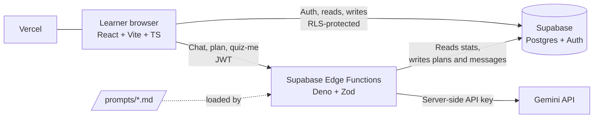

# CloudMwalimu

**Study smart. Know when you're ready.**

An unofficial, AI-powered exam-prep platform for **Microsoft Azure Fundamentals (AZ-900)**, built for African learners, Kenya first. Built for the Power Learn Project **Vibe Coding Hackathon: AZ-900 Exam Prep Edition** (#1MillionDevs).

> **Unofficial study tool, not affiliated with or endorsed by Microsoft.** It contains no real exam questions. All questions are original and based on the public AZ-900 skills outline on Microsoft Learn.

- **Live demo:** `https://cloudmwalimu.vercel.app`
- **Demo video:** `[DEMO VIDEO LINK]`
- **Demo account:** `amina@example.com` / `DemoPass123!` (pre-filled with realistic practice history)

---

## The problem

Learners prepare for AZ-900 with scattered resources and still face three questions: *Why was that answer wrong? What should I study next? Am I actually ready?* Cloud concepts also feel abstract, especially without local, real-life examples.

When preparing for AZ-900, many students find cloud models and IAM policies confusing because textbook examples assume European or US enterprise contexts. CloudMwalimu grounds abstract cloud architecture in familiar concepts like M-Pesa agents and SACCO governance.

## The solution

One connected learning loop instead of six separate tools:

```
Diagnostic → Readiness score → Personal study plan → Quiz with explanations → Flashcards from your mistakes → AI Study Buddy
```

Every quiz answer updates the readiness dashboard, adjusts the study plan and feeds the flashcard queue.

### Features

| Challenge | Feature | What it does |
|---|---|---|
| Smart Quiz Builder | **Quiz** | Diagnostic, domain practice, weak-areas and timed mock modes. Instant feedback with why the answer is right and why each wrong option is wrong, plus a Microsoft Learn link. |
| Flashcard Coach | **Flashcards** | Leitner 5-box spaced repetition (1, 2, 4, 7, 14 day intervals). Missed questions become cards automatically. Keyboard shortcuts. |
| Personal Study Planner | **Planner** | Day-by-day plan from exam date, hours per day and real weak areas. Re-plan any time. Export to `.ics`. |
| AI Study Buddy | **Study Buddy** | Explains Azure concepts with Kenyan analogies in English, Kiswahili or Sheng. Generates fresh practice questions on request. |
| Readiness Tracker | **Dashboard** | Readiness gauge, per-domain bars, topic heatmap, 14-day trend, streak, and the exact gap to "exam-ready". |

### Readiness rule

"Exam-ready" unlocks only when **all** of these hold:

1. At least 30 questions answered.
2. Over the last 50 answered questions, overall accuracy is at least 80%.
3. Every domain is at least 70% over the same window, with at least 8 answers in that domain (otherwise the dashboard shows "not enough data").

Until then the dashboard shows the exact gap, for example "Raise Governance by 9% to unlock". The logic is a single pure function, `calculateReadiness()`, covered by unit tests. AI-generated questions never count toward readiness.

---

## Architecture



**Key design decisions**

- **The Gemini key never reaches the browser.** All AI calls go through Edge Functions that verify the user's JWT, validate input with Zod, apply per-user rate limits and return safe errors.
- **A human-reviewable question bank carries graded content.** AI is used for explanations, analogies, plans and extra practice, not for the questions that decide your readiness score.
- **Row Level Security on every table.** Users read and write only their own rows. The `questions` table is read-only for authenticated users.
- **Code enforces what prompts request.** AI output is validated against schemas and hard constraints (time budgets, valid topic IDs, option structure) with one retry on failure.

## Tech stack

| Layer | Choice |
|---|---|
| Frontend | React, Vite, TypeScript (strict), Tailwind CSS, shadcn/ui, Recharts, Framer Motion, React Router, TanStack Query |
| Backend and database | Supabase (Postgres, Auth, Row Level Security, Edge Functions) |
| AI | Gemini API via Edge Functions (model set by `GEMINI_MODEL`) |
| Deployment | Vercel (frontend), Supabase (backend) |
| Tooling | Antigravity (build), Claude (planning, prompts, content), Gemini (refinement and in-app AI) |

### Routing Architecture & Accessibility

- **`/` (Public)**: Landing Page featuring the Bolt design system with WCAG AA compliant color contrast.
- **`/auth` (Public)**: Real Supabase Authentication portal for registration and login.
- **`/dashboard` (Protected)**: Main application Bento Grid readiness dashboard.
- **Route Guards**: Unauthenticated access to `/dashboard` redirects strictly to `/auth`. Authenticated users visiting `/` or `/auth` redirect to `/dashboard`.

**Design system:** flat solid colours only, light and dark themes, mobile-first. A CI-style script (`npm run check:no-gradients`) fails if any gradient appears in the source.

## Project structure

```
/src                  React app
/supabase
  /migrations         Tables, indexes, RLS policies
  /functions          buddy-chat, generate-plan, generate-questions
  /seed               questions.json + seed script
/prompts              study-buddy.md, planner.md, question-generator.md
/docs                 README.md, pitch-outline.md, demo-script.md
.env.example
vercel.json
```

---

## Content accuracy

- Domains, topics and weights come from the official Microsoft Learn AZ-900 study guide (skills measured as of **July 20, 2026**):
  Cloud concepts 25 to 30%, Azure architecture and services 35 to 40%, Azure management and governance 30 to 35%.
- The seed bank has **90 original questions** (26 / 34 / 30 across the three domains), each mapped to one exact outline bullet via `topic_id`.
- Questions ship with `reviewed = false` until a human has checked them. Mark them reviewed after verification against Microsoft Learn.
- The outline changes over time. Re-check the study guide before reusing the bank for a later exam version.

## Prompt engineering

All system prompts live in `/prompts` and follow one structure: role, rules, output format, examples, refusal behaviour, design rationale and an evaluation checklist.

| Prompt | Purpose | Safeguards |
|---|---|---|
| `study-buddy.md` | Three-part explanations (definition, Kenyan analogy, Azure mapping) in English, Kiswahili or Sheng | 150-word cap, no invented features, scope limits, injection resistance, one check question |
| `planner.md` | Strict-JSON study plans from real stats | Zod validation, time-budget checks in code, `null` means unknown, honest warnings, retry once |
| `question-generator.md` | Fresh original practice questions on one outline objective | Confidence gate, structural checks, originality rules, `avoid_questions`, AI-labelled |

---

## Getting started

### Prerequisites

Node.js 20+, a Supabase project, a Gemini API key, the Supabase CLI.

### 1. Install

```bash
git clone [YOUR REPO URL]
cd cloudmwalimu
npm install
```

### 2. Environment variables

Copy `.env.example` to `.env` and fill in:

| Variable | Where it is used | Notes |
|---|---|---|
| `VITE_SUPABASE_URL` | Browser | Public project URL |
| `VITE_SUPABASE_ANON_KEY` | Browser | Public anon key, safe with RLS |
| `SUPABASE_SERVICE_ROLE_KEY` | Seed script only | **Never** put in client code or Vercel client variables |
| `GEMINI_API_KEY` | Edge Function secret only | **Never** in client code |
| `GEMINI_MODEL` | Edge Function secret | Model name, changeable without code edits |

### 3. Database

```bash
supabase login
supabase link --project-ref [YOUR PROJECT REF]
supabase db push          # applies migrations and RLS
npm run seed              # loads domains, topics and questions (adjust to the actual script name)
```

### 4. Edge Functions

```bash
supabase secrets set GEMINI_API_KEY=[YOUR KEY] GEMINI_MODEL=[MODEL NAME]
supabase functions deploy buddy-chat
supabase functions deploy generate-plan
supabase functions deploy generate-questions
```

### 5. Run locally

```bash
npm run dev
```

### 6. Quality checks

```bash
npm run test                  # readiness and Leitner unit tests
npm run check:no-gradients    # design-system guard
npm run build
```

### 7. Deploy

1. Push the repo to GitHub.
2. Import it into Vercel. Set `VITE_SUPABASE_URL` and `VITE_SUPABASE_ANON_KEY`.
3. Deploy. `vercel.json` handles single-page-app routing.
4. In Supabase Auth settings, add the Vercel URL to the allowed redirect URLs (needed for Google sign-in).

---

## Testing and quality

- Unit tests for `calculateReadiness()` and the Leitner scheduler.
- Strict TypeScript, no `any`.
- Loading, empty and error states on every screen.
- Prompt evaluation checklists in each `/prompts` file.
- Lighthouse mobile performance target: 90 or above on the landing page.

## Privacy

Learner data (attempts, cards, plans, chat history) is stored in Supabase and protected by Row Level Security so each user can only access their own rows. Chat messages are sent to the Gemini API to generate replies. Do not enter personal or confidential information into the Study Buddy.

## Roadmap

- More certifications on the same engine: AZ-104, AWS Cloud Practitioner, Google Cloud Digital Leader, SC-900, AI-900.
- More local languages, reviewed by native speakers.
- Offline-first PWA for low-bandwidth learners.
- Cohort and study-group mode for campuses, bootcamps and SACCO training programmes.
- Educator view: cohort readiness across topics.
- Community-contributed and reviewed question bank.

## Acknowledgements

Built for the Power Learn Project #1MillionDevs Vibe Coding Hackathon. Content is based on the publicly available AZ-900 skills outline on Microsoft Learn. "Microsoft" and "Azure" are trademarks of Microsoft Corporation; this project is independent and unofficial.

## Licence

MIT
